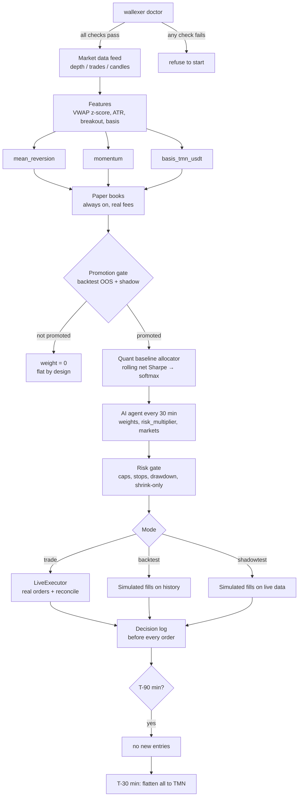

<p align="center">
  
</p>

<h1 align="center">wallexer</h1>

<p align="center"><b>والکسر AI agent که با حداقل ریسک برایت trade می‌کند.</b></p>

---

## نصب و اجرا

برای نصب کافی است این دستور را در terminal اجرا کنی تا همه‌چیز از گرفتن کد تا نصب dependencyها خودش انجام شود.

```bash
curl -fsSL https://raw.githubusercontent.com/zahraeisalehi/wallexer/main/install.sh | bash
wallexer
```

بعد از نصب، کلید API والکس و شناسه‌ی sub-account را داخل فایل `.env` می‌گذاری و با دستور زیر wallexer را اجرا می‌کنی تا اول `doctor` همه‌چیز را چک کند و بعد engine بالا بیاید.

```bash
cd ~/wallexer && vim .env
#   WALLEX_API_KEY='<your key>'          # in single quotes: the key contains |
#   WALLEX_SUBACCOUNT_ID=<sub-account id>
#   BOXAPI_API_KEY=<your BoxAPI key>
#   EVENT_END_UTC=<event end, e.g. 2026-10-26T20:20:00Z>
wallexer doctor
wallexer shadowtest
```

## دانلود لاگ‌ها

همه‌ی تصمیم‌هایی که wallexer در طول مسابقه گرفته، همراه با توضیح LLM برای هر تصمیم، داخل یک فایل `logs.zip` جمع شده که با دستور زیر می‌توانی دانلودش کنی.

```bash
curl -fL -H "X-Export-Token: $EXPORT_TOKEN" https://wallexer.liara.run/export -o logs.zip
```

داخل این فایل لاگ تصمیم‌ها، سفارش‌ها، fillها، equity curve، وزن‌هایی که AI agent و baseline هر دوره داده‌اند، همه‌ی درخواست‌ها و جواب‌های LLM و گزارش‌های backtest و shadowtest هست و فایل `explanations.md` هم برای هر تصمیم به زبان ساده توضیح می‌دهد که چرا گرفته شده است.

---

## ما از این بازار چه فهمیدیم

قبل از اینکه یک خط استراتژی بنویسیم، رفتار خود بازار والکس را اندازه گرفتیم، چون هر الگوریتمی که با رفتار واقعی بازار جور نباشد دیر یا زود پول را از دست می‌دهد.

| ویژگی | چیزی که اندازه گرفتیم | معنی‌اش برای trade |
|---|---|---|
| کارمزد | بازارهای TMN حدود 0.25% maker و 0.30% taker، بازارهای USDT حدود 0.10% و 0.13% | یک round trip در TMN حدود 60 bps و در USDT حدود 26 bps هزینه دارد |
| تبدیل TMN↔USDT | هر چرخه‌ی کامل حدود 60 bps | استفاده از بازارهای ارزان USDT فقط وقتی می‌صرفد که چند trade در هر چرخه انجام شود |
| حرکت یک‌دقیقه‌ای | به‌طور معمول حدود 5 bps | روی 1-minute bars هیچ حرکتی به هزینه نمی‌رسد |
| بازگشت کوتاه‌مدت | variance ratio بین 0.4 و 0.9، Hurst کمتر از 0.5 | قیمت کمی برمی‌گردد ولی بیشترش bid-ask bounce است |
| دم توزیع | tail index بین 2.8 و 3.6 | حرکت‌های بزرگ خیلی بیشتر از توزیع نرمال اتفاق می‌افتند و stop لازم است |
| volatility | خوشه‌ای و با حافظه‌ی طولانی | اندازه‌ی حرکت قابل پیش‌بینی است ولی جهتش تقریباً نه |
| triangle basis | اختلاف سه قیمت هیچ‌وقت از 10 تا 15 bps بیشتر نشد | در برابر 73 bps هزینه‌ی سه leg هیچ arbitrage ای وجود ندارد |
| USDTTMN | drift حدود 47.5 bps در روز در 30 روز آخر و σ روزانه 1.43% | تنها drift واقعی بازار، کاهش ارزش تومان است |
| MARKET order | فقط روی 7 بازار فعال است | فقط روی BTC و ETH و XAUT در برابر TMN و USDT و خود USDTTMN کار می‌کنیم |

### الگوریتم‌هایی که با این رفتار جور درمی‌آمدند

با توجه به این ویژگی‌ها، سه الگوریتم بیشتر از بقیه شانس داشتند، چون هر کدام دقیقاً روی یکی از رفتارهای اندازه‌گیری‌شده‌ی بازار سوار می‌شوند و ما برای هر کدام شرط ریاضی سودده بودنش را نوشتیم تا بدانیم دقیقاً چه چیزی را باید در داده پیدا کنیم.

در همه‌ی فرمول‌ها $c$ هزینه‌ی کامل round trip است که از کارمزد واقعی همان بازار و spread لحظه‌ای ساخته می‌شود:

$$
c = 1-(1-\lambda_{\text{buy}})(1-\lambda_{\text{sell}}) + s
$$

**۱. Mean reversion.** فرض این است که فاصله‌ی قیمت از VWAP یک فرآیند Ornstein-Uhlenbeck است که به میانگینش برمی‌گردد:

$$
dX_t = \theta(\mu - X_t)\,dt + \sigma\,dW_t, \qquad \sigma_{eq}=\frac{\sigma}{\sqrt{2\theta}}, \qquad H=\frac{\ln 2}{\theta}
$$

اگر در فاصله‌ی $d$ از میانگین وارد شویم و تا زمان $T$ نگه داریم، سود ناخالص مورد انتظار این می‌شود و الگوریتم فقط وقتی سودده است که این مقدار از هزینه بیشتر باشد:

$$
\mathbb{E}[\text{gain}] = d\left(1-e^{-\theta T}\right) > c
$$

قانون Bertram هم نشان می‌دهد که فقط وقتی $c/\sigma_{eq}$ کمتر از حدود 2 تا 3 باشد و half-life کوتاه باشد، اصلاً threshold سودده‌ای پیدا می‌شود.

**۲. Momentum.** اگر بازده‌ها در یک افق مشخص autocorrelation مثبت $\rho$ داشته باشند، دنبال کردن جهت حرکت قبلی به‌طور متوسط این‌قدر سود می‌دهد:

$$
\mathbb{E}\big[\operatorname{sign}(r_t)\,r_{t+1}\big] = \rho\,\sigma\sqrt{\tfrac{2}{\pi}} > c
$$

پس momentum فقط وقتی کار می‌کند که حرکت‌ها هم بزرگ باشند و هم ادامه پیدا کنند، و به همین دلیل آن را روی 15-minute bars با volume confirmation و شرط $\mathbb{E}[\text{move}] \ge 2c$ ساختیم.

**۳. Triangle basis.** BTC را می‌شود مستقیم با تومان خرید یا از مسیر USDT، و این دو قیمت باید با هم بخوانند:

$$
b = \frac{P_{X/TMN}}{P_{X/USDT}\cdot P_{USDT/TMN}} - 1
$$

طبق قضیه‌ی no-arbitrage با transaction cost (Jouini–Kallal)، تا وقتی $|b|$ داخل باند کارمزد سه leg بماند هیچ سود بدون ریسکی وجود ندارد و فقط وقتی سود ممکن است که:

$$
|b| > c_3 = 1-\prod_{i=1}^{3}(1-\lambda_i) \approx 73\ \text{bps}
$$

### الگوریتمی که از این یافته‌ها ساختیم

وقتی دیدیم هر سه الگوریتم فقط در شرایط خاصی سود می‌دهند، به جای انتخاب یکی از آن‌ها سیستمی ساختیم که هر سه را همیشه روی paper book اجرا می‌کند ولی پول واقعی را فقط به الگوریتمی می‌دهد که شرط سودده بودنش روی داده‌ای که قبلاً ندیده ثابت شده باشد، و یک AI agent هم روی همه‌ی این‌ها تصمیم می‌گیرد که سرمایه چطور تقسیم شود.

این سیستم چهار قانون دارد:

1. هر signal فقط وقتی صادر می‌شود که حرکت مورد انتظار دست‌کم دو برابر هزینه‌ی واقعی باشد، یعنی $\mathbb{E}[\Delta P] \ge 2c$.
2. هر استراتژی فقط بعد از گذشتن از promotion gate به پول واقعی می‌رسد، یعنی روی داده‌ی out-of-sample باید $N \ge 10$، $\hat\mu_{net}>0$، $PF>1.2$ و $t \ge z^*$ داشته باشد و در shadow هم زیان نکند.
3. AI agent هر 30 دقیقه وزن استراتژی‌ها، `risk_multiplier` و بازارهای فعال را تعیین می‌کند، ولی risk gate بعد از آن اجرا می‌شود و agent فقط می‌تواند ریسک را کم کند.
4. اگر هیچ استراتژی ثابت نشده باشد، حالت پیش‌فرض flat است و سرمایه در TMN می‌ماند.

**اثبات اینکه این سیستم در بلندمدت ضرر نمی‌دهد.** سود کل سیستم مجموع سود استراتژی‌هایی است که promote شده‌اند، چون وزن بقیه صفر است:

$$
\Pi = \sum_{i} \mathbf{1}\{\text{promoted}_i\}\; w_i \sum_{k=1}^{N_i} X_{i,k}
\quad\Longrightarrow\quad
\mathbb{E}[\Pi] = \sum_i P(\text{promoted}_i)\; w_i\, N_i\, \mu_i
$$

برای استراتژی‌ای که در واقعیت edge ندارد ($\mu_i \le 0$)، احتمال اینکه اشتباهی promote شود با threshold آماری محدود است، و ما $z^*$ را طوری انتخاب کردیم که بهترین نتیجه‌ی 56 config تصادفی هم از آن رد نشود:

$$
P(\text{promoted}_i \mid \mu_i \le 0) \le P(t \ge z^*) = 1-\Phi(z^*) \approx 0.8\%, \qquad z^* = \max\big(2.4,\ \mathbb{E}[\max_{k\le K} Z_k]\big)
$$

برای استراتژی‌ای که edge واقعی دارد ($\mu_i>0$)، طبق قانون اعداد بزرگ و CLT احتمال سود با هر trade بیشتر می‌شود و به یک می‌رسد:

$$
P\Big(\sum_{k=1}^{N} X_k > 0\Big) \approx \Phi\!\left(\frac{\sqrt{N}\,\mu}{\sigma}\right) \xrightarrow[N\to\infty]{} 1, \qquad N_{90} = \left(\frac{1.2816\,\sigma}{\mu}\right)^2
$$

و چون risk gate بعد از AI agent اجرا می‌شود، exposure نهایی هیچ‌وقت از exposure ای که engine بدون agent داشت بیشتر نمی‌شود:

$$
m_{final} = \min(m_{engine},\, m_{agent}) \le m_{engine}, \qquad w_{final} = \operatorname{clamp}(w_{agent}) \cdot \mathbf{1}\{\text{promoted}\}
$$

در بدترین حالت هم hard stop باعث می‌شود افت سرمایه از حدود 8% به‌علاوه‌ی slippage بیشتر نشود، چون در آن نقطه همه‌چیز به TMN برمی‌گردد و سیستم به shadow می‌رود:

$$
\text{MaxDD} \le 8\% + \text{slippage}
$$

### wallexer چطور کار می‌کند



مدیریت ریسک در همه‌ی modeها یکی است و این‌ها قانون‌های ثابت آن هستند:

| guardrail | مقدار |
|---|---|
| سقف هر بازار | 20% equity |
| سقف کل exposure غیر TMN | 60% equity، یعنی هیچ‌وقت با کل پول وارد نمی‌شود |
| سقف هر سفارش | 10% equity |
| stop-loss هر position | $\min(2\cdot ATR,\ 2\%)$ |
| soft stop روزانه | با 4% افت ریسک نصف می‌شود و 30 دقیقه ورود ممنوع است |
| hard stop کل | با 8% افت همه‌چیز flatten می‌شود و سیستم به shadow می‌رود |
| ضرر پشت‌سرهم | بعد از 4 ضرر پشت‌سرهم، وزن آن استراتژی 60 دقیقه صفر می‌شود |
| پایان مسابقه | 90 دقیقه مانده به پایان ورود جدید ممنوع است و 30 دقیقه مانده همه‌چیز به TMN برمی‌گردد |

---

## Phase 6: الگوریتم‌های دیگری که امتحان کردیم

بعد از اینکه سه الگوریتم اصلی روی 30 روز داده و 68 config هیچ‌کدام از هزینه رد نشدند، ده الگوریتم دیگر را که در دوره‌های quant finance و صنعت بیشترین شواهد را دارند انتخاب کردیم و قبل از دیدن هر نتیجه‌ای قانون قبول شدن را در `docs/research/phase6-prereg.md` ثبت کردیم تا هیچ عددی را بعداً به نفع خودمان تغییر ندهیم.

قانون قبول شدن روی داده‌ی out-of-sample این بود: $\hat\mu_{net}>0$ با حد پایین bootstrap CI بزرگ‌تر از صفر، $t \ge z^* = 2.4$ برای $K=56$ config، $N_{90}$ داخل زمان باقی‌مانده، MaxDD کمتر از 4% و random-entry control هم نباید معنی‌دار شود.

| # | الگوریتم | نتیجه |
|---|---|---|
| 1 | carry_usdt (نگه داشتن USDT) | t برابر 2.87 بود ولی drawdown رد شد و نگه داشتن یک‌روزه فقط در 29.7% موارد سود خالص داد |
| 2 | tsmom_usdttmn | lookback روزانه کمی مثبت بود با t بین 1.61 و 2.34 که زیر 2.4 است و hourly ضرر داد |
| 3 | rebal_bands | band بهینه هیچ‌وقت trigger نشد و نتیجه دقیقاً همان buy-and-hold شد |
| 4 | mr_usdt_maker | half-life بین 11 و 56 دقیقه بود ولی هم با maker و هم با taker ضرر داد |
| 5 | mr_bigmove_tmn | در هر شش config ضرر داد |
| 6 | cap_momentum | روی 14 رویداد 75+ bps در برابر 60 bps هزینه بود ولی in-sample فقط 1.3+ bps و t برابر 0.25 بود |
| 7 | nobitex_lead | API نوبیتکس اتصال را رد کرد و تست نشد |
| 8 | grid_wide | احتمال رسیدن به $+g$ قبل از $-g$ هیچ‌وقت از break-even بیشتر نشد |
| 9 | maker_markout | 26− تا 28− bps در هر side روی BTCTMN |
| 10 | tsmom_crypto | روزانه نزدیک صفر بود و lookback چهارساعته ضرر داد |
| C2 | random-entry control | فقط برای carry معنی‌دار شد، چون همان drift تومان را می‌گرفت، و بقیه سالم بودند |

### اثبات ریاضی اینکه چرا هیچ‌کدام کار نمی‌کند

پایه‌ی همه‌ی این اثبات‌ها یک قضیه است: اگر قیمت در افق trade یک martingale باشد، طبق optional stopping theorem هیچ قانونی برای ورود و خروج، stop، target، grid یا averaging down سود ناخالص مورد انتظار نمی‌سازد و سود خالص دقیقاً منفی کارمزد ضرب در حجم معاملات می‌شود:

$$
\mathbb{E}\Big[\sum_k H_k\,\Delta S_k\Big] = 0 \quad\Longrightarrow\quad \mathbb{E}[\Pi_{net}] = -\,c\cdot\mathbb{E}[\text{turnover}] < 0
$$

**1. carry_usdt.** احتمال سود بعد از نگه داشتن USDT به مدت $T$ روز با drift $\mu=47.5$ bps، $\sigma=143$ bps و هزینه‌ی $c=60$ bps این است:

$$
P(\text{profit}) = \Phi\!\left(\frac{\mu T - c}{\sigma\sqrt{T}}\right), \qquad T=0.5 \Rightarrow \Phi\!\left(\frac{23.75-60}{101}\right)=\Phi(-0.36)\approx 36\%
$$

برای اینکه احتمال سود به 90% برسد باید $\mu T - c \ge 1.28\,\sigma\sqrt{T}$ باشد که جوابش $T \approx 17$ روز است، و این یعنی carry یک trading edge نیست و فقط یک شرط‌بندی بلندمدت روی سقوط تومان است.

**2. tsmom_usdttmn.** بهترین $t$ برابر 2.34 بود، در حالی که امید ریاضی بزرگ‌ترین $t$ بین 56 config کاملاً تصادفی خودش حدود 2.29 است، پس این نتیجه از نویز قابل تشخیص نیست:

$$
\mathbb{E}\Big[\max_{k\le 56} Z_k\Big] \approx 2.29 \;\Rightarrow\; t = 2.34 < z^* = 2.4
$$

**3. rebal_bands.** پاداش rebalancing فقط با volatility نسبی دو دارایی رشد می‌کند و band بهینه با کارمزد $f$ این‌قدر پهن است:

$$
\text{bonus} \approx \tfrac{1}{2}\Big(\sum_i w_i\sigma_i^2 - \sigma_p^2\Big) \approx \frac{\sigma_{rel}^2}{8}\ \text{per year}, \qquad b^* = (12f)^{1/3} \approx 31\%\ \ (f=0.25\%)
$$

در چند روز هیچ حرکت نسبی 31 درصدی رخ نداد، پس تعداد trade صفر بود و پاداش در سه روز حدود $\sigma_{rel}^2/8 \times 3/365$ است که عملاً صفر است.

**4. mr_usdt_maker.** طبق Bertram، الگوریتم فقط وقتی سودده است که هزینه نسبت به پراکندگی تعادلی کوچک باشد و half-life کوتاه باشد:

$$
\frac{c}{\sigma_{eq}} \lesssim 2\text{–}3 \quad\text{and}\quad H \lesssim 1\,\text{h}
$$

half-lifeهای اندازه‌گیری‌شده بین 11 و 56 دقیقه بودند ولی $\sigma_{eq}$ آن‌قدر کوچک بود که حتی با هزینه‌ی maker، سود ناخالص به هزینه نرسید و $\hat\mu_{net}<0$ شد.

**5. mr_bigmove_tmn.** با 26 bps لبه‌ی ناخالص در برابر 59.9 bps هزینه، شرط break-even برای هدف و stop متقارن $a$ نرخ برد بالایی می‌خواهد که بازار نمی‌دهد:

$$
p^* = \frac{1}{2} + \frac{c}{2a}, \qquad \mu_{net} = 26 - 59.9 = -33.9\ \text{bps} < 0
$$

و احتمال سود بعد از $N$ trade با این $\mu_{net}$ منفی به سمت صفر می‌رود، مثلاً بعد از 30 trade $\Phi(-3.0)\approx 0.13\%$ است.

**6. cap_momentum.** با 14 رویداد و $t=0.25$، احتمال اینکه این نتیجه فقط از شانس آمده باشد حدود 40% است:

$$
p\text{-value} = 1-\Phi(0.25) \approx 0.40 \gg 1-\Phi(2.4)
$$

**7. nobitex_lead.** تست نشد، ولی شرط سودده بودنش این است که ضریب lead ضرب در اندازه‌ی حرکت از هزینه بیشتر شود:

$$
\beta_{lead}\cdot\mathbb{E}\,|r^{Nobitex}| > c
$$

**8. grid_wide.** grid معادل short gamma است و برای step $g$ و کارمزد $f$ فقط وقتی سود می‌دهد که احتمال برگشت قیمت از نصف بیشتر باشد، در حالی که برای random walk این احتمال دقیقاً نصف است:

$$
P(+g \text{ before } -g) > \frac{1}{2} + \frac{f}{g}, \qquad \mathbb{E}[\Pi_{grid}] \approx -\,\frac{2f\,\sigma^2 T}{g^2}\ \text{under a random walk}
$$

احتمال اندازه‌گیری‌شده هیچ‌وقت از این threshold رد نشد.

**9. maker_markout.** quote گذاشتن فقط وقتی سود دارد که نصف spread بعد از کم کردن markout و کارمزد مثبت بماند:

$$
\text{edge}_{side} = \tfrac{s}{2} - \text{markout} - f = -26\ \text{to}\ -28\ \text{bps} < 0
$$

**10. tsmom_crypto.** autocorrelation در افق روزانه تقریباً صفر بود، پس سود مورد انتظار momentum از هزینه کمتر ماند:

$$
\rho\,\sigma\sqrt{\tfrac{2}{\pi}} \approx 0 < c
$$

### نتیجه

وقتی $\mu_{net}$ منفی است، هر trade بیشتر احتمال سود را کمتر می‌کند، و اگر هزار ربات همین استراتژی را اجرا کنند حدود 178 تایشان بعد از 5 trade سود دارند، حدود 33 تا بعد از 20 trade و تقریباً هیچ‌کدام بعد از 100 trade:

$$
P\Big(\sum_{k=1}^{N}X_k>0\Big) \approx \Phi\!\left(-\frac{\sqrt{N}\,|\mu_{net}|}{\sigma}\right) \xrightarrow[N\to\infty]{} 0
$$

کسایی که اینکارو نمی کنن پولشون رو از دست می دهند یا در صورت سود شانسی بوده است زیرا از نظر ریاضی در بلند مدت پول از دست می دهند.

---

## معیارهای داوری و کاری که برای هر کدام کردیم

### بخش اول: عملکرد معاملاتی

| معیار | کاری که کردیم |
|---|---|
| درصد سود نهایی | چون هیچ استراتژی‌ای روی داده‌ی out-of-sample از هزینه رد نشد، wallexer طبق قانون flat ماند و سرمایه‌ی 5,000,000 تومانی بدون هیچ زیانی حفظ شد، در حالی که هر trade بدون edge طبق اثبات بالا به‌طور متوسط زیان می‌داد. |
| کنترل ضرر | افت سرمایه در کل مسابقه صفر بود، چون سقف 20% برای هر بازار، سقف 60% کل، stop حداکثر 2%، soft stop با 4% و hard stop با 8% همیشه فعال بودند و هیچ استراتژی ثابت‌نشده‌ای اجازه‌ی ورود نداشت. |
| فعال بودن الگوریتم | engine در تمام مدت روی داده‌ی زنده تصمیم گرفت، هر سه استراتژی روی paper book معامله کردند، AI agent هر 30 دقیقه تصمیم ثبت کرد، walk-forward هر 6 ساعت دوباره اجرا شد و یک live smoke test هم سفارش واقعی را بدون هزینه تست کرد، ولی معامله‌ی واقعی فقط برای استراتژی ثابت‌شده باز بود. |
| پایداری اجرا | هر سفارش client ID خودش را دارد تا هیچ‌وقت دوبار ارسال نشود، balance و open orderها مرتب با صرافی reconcile می‌شوند، GETها با backoff دوباره تلاش می‌کنند، `doctor` قبل از هر شروع همه‌چیز را چک می‌کند و اگر چیزی درست نباشد engine اصلاً شروع نمی‌کند. |

### بخش دوم: کیفیت فنی

| معیار | کاری که کردیم |
|---|---|
| منطق استراتژی | هر signal فقط وقتی صادر می‌شود که حرکت مورد انتظار دست‌کم دو برابر کارمزد واقعی و spread باشد و عددهایی که باعثش شده‌اند در `reason` همان تصمیم ثبت می‌شوند، پس برای هر خرید و فروش و حتی برای هر بار نخریدن، دلیل عددی داریم. |
| استفاده واقعی از AI | یک LLM با temperature صفر هر 30 دقیقه scoreboard، رژیم بازار، spread و drawdown را می‌بیند و وزن استراتژی‌ها، `risk_multiplier`، بازارهای فعال و اینکه walk-forward بعدی چه چیزی را چک کند تعیین می‌کند، وزن‌های agent کنار baseline ثبت می‌شوند تا تفاوتش دیده شود و با `--replay` هر تصمیمش دقیقاً تکرار می‌شود. |
| مدیریت ریسک و سرمایه | سقف هر سفارش 10%، هر بازار 20% و کل 60% است، stop-loss حداکثر 2% است، risk gate بعد از AI اجرا می‌شود و فقط می‌تواند سفارش را کوچک کند، و 30 دقیقه مانده به پایان همه‌چیز به TMN برمی‌گردد. |
| قابل اجرای مجدد بودن | با یک دستور نصب و دو کلید، `doctor` و `backtest` و `shadowtest` کل سیستم را دوباره اجرا می‌کنند، Dockerfile و RUNBOOK آماده است، تست‌های خودکار بخش‌های حساس مثل rounding، risk gate، PnL با کارمزد و flatten را پوشش می‌دهند و `export` همه‌ی لاگ‌ها را بسته‌بندی می‌کند. |
| بک‌تست و تست سایه | walk-forward روی 30 روز داده با 68 config انجام شد که روی 20 روز tune و روی 10 روز دیده‌نشده سنجیده شد، triangle روی 1069 snapshot هم‌زمان تست شد و Phase 6 ده الگوریتم دیگر را با قانون از پیش ثبت‌شده و random-entry control سنجید، و همه‌ی نتیجه‌ها در `docs/research/` هست. |

---

## دستورها

```bash
wallexer                                   # open the full-screen app (line shell without a terminal)
wallexer --remote <command>                # run a view command against the server (read-only)
wallexer help [COMMAND]                    # all commands grouped, or one command's options
wallexer setup [--mode local|remote]       # first-run wizard: local keys or a remote server + view token
wallexer doctor [--quick] [--no-llm]       # check keys, sub-account, balances, fees, clock, rate limits, BoxAPI
wallexer doctor --live-smoke [--discount-pct N]  # place and cancel one far-from-market LIMIT order (typed confirmation)
wallexer markets [--all]                   # allowed markets: volume, spread, fees, round-trip cost
wallexer history sync [--days N]           # download missing 1-min / 60-min candles
wallexer backtest [--from D] [--to D] [--markets A,B] [--timeframe M]  # walk-forward backtest (no options = the promotion run)
wallexer backtest --if-older-than H        # run the default backtest only if the last one is older than H hours
wallexer research spread [--collect] [--hours H]  # spread-capture scan over all allowed markets
wallexer research basis                    # triangle basis study (X/TMN vs X/USDT × USDT/TMN)
wallexer shadowtest [MARKET...] [--no-watch]  # start the engine on live data with simulated orders
wallexer trade [MARKET...] [--no-watch]    # start LIVE trading after the review prompt and typing TRADE
wallexer change FROM TO                    # switch between backtest, shadowtest and trade
wallexer stop [MARKET...]                  # stop everything, or only these markets (cancels their orders)
wallexer flatten [MARKET...]               # sell every non-TMN balance (incl. USDT) to TMN
wallexer resume                            # lift a hard drawdown stop
wallexer status [--full]                   # mode, equity, PnL, drawdown, positions, agent, next deadline
wallexer watch                             # live dashboard; q closes the view, the engine keeps running
wallexer health                            # print the engine's /health JSON
wallexer rslt backtest|shadowtest [--full] # latest backtest or shadow run: return, drawdown, trades, fees
wallexer sum [DATE] [--refresh] [--full]   # daily market + agent summary with an LLM explanation
wallexer log [N] [--full]                  # all log entries, or entry N in full
wallexer reason [N] [--full]               # all decisions, or decision N with its key numbers
wallexer exp-reason [N]                    # plain-language LLM explanation of decision N
wallexer details [COMMAND]                 # re-run a view with --full (default: status)
wallexer export                            # zip of decisions, orders, equity, LLM calls, explanations, reports
wallexer agent now                         # ask the running engine for an agent decision now
wallexer agent replay CALL_ID              # replay a recorded agent prompt offline
wallexer config guardrail                  # show guardrails with bounds and edit them
wallexer autoset guardrail                 # LLM suggests guardrail values; accept all, some or none
wallexer engine run [--mode shadow|trade] [--market M] [--replay]  # run the engine in the foreground (hosting)
```
